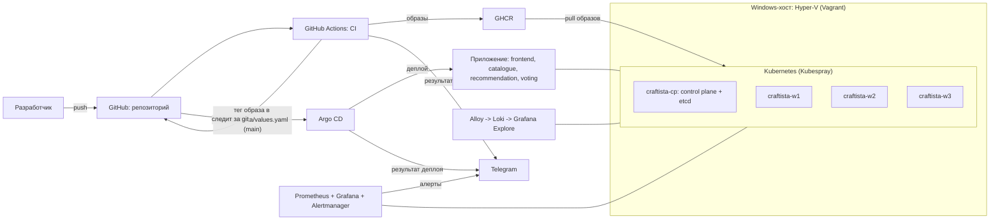
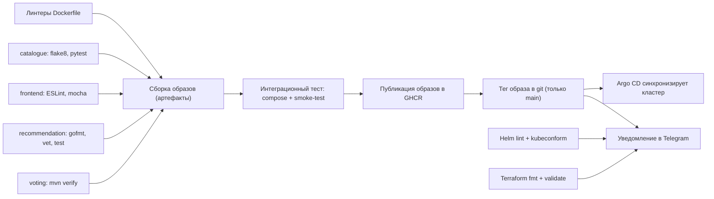

# Craftista: DevOps-инфраструктура 

Дипломный проект. Приложение [Craftista](https://github.com/chronicsdv/diplom/tree/main/craftista) (четыре микросервиса) развёрнуто в Kubernetes-кластере, который целиком создаётся автоматически: виртуальные машины, Kubernetes, GitOps-доставка, мониторинг, логирование и оповещения.

## Что реализовано

| Задача | Решение |
|---|---|
| Инфраструктура как код | Vagrant (ВМ в Hyper-V), Ansible + Kubespray (Kubernetes), Helm и Kustomize (стек) |
| Запуск «с нуля одной командой» | `./up.sh` или workflow `infra` в GitHub Actions |
| CI | GitHub Actions: линтеры, тесты, сборка образов (артефакты), интеграционный тест, публикация в GHCR |
| CD (GitOps) | CI прописывает тег образа в git (только `main`), Argo CD синхронизирует кластер |
| Мониторинг | kube-prometheus-stack: Prometheus, Grafana, Alertmanager |
| Логирование | Grafana Alloy собирает логи, Loki хранит их, просмотр в Grafana (Explore) |
| Оповещения | Telegram: алерты Alertmanager, результат CI, результат деплоя Argo CD |

## Архитектура



### Кластер

| Узел | Роль | Память | vCPU | IP (резерв в роутере) |
|---|---|---|---|---|
| craftista-cp | control plane, etcd | 5 ГБ | 4 | 192.168.0.105 |
| craftista-w1 | worker | 5 ГБ | 4 | 192.168.0.103 |
| craftista-w2 | worker | 5 ГБ | 4 | 192.168.0.104 |
| craftista-w3 | worker | 5 ГБ | 4 | 192.168.0.102 |

- ОС: Ubuntu Server 24.04 (box `gusztavvargadr/ubuntu-server-2404-lts`), гипервизор Hyper-V.
- Kubernetes ставит Kubespray `v2.32.0` (версия зафиксирована в `up.sh`), сеть Calico, хранилище `local-path`.
- На Hyper-V Vagrant не умеет статические IP, поэтому у каждой ВМ фиксированный MAC, под который в роутере зарезервирован адрес.

### Стек

| Компонент | Версия | Как ставится |
|---|---|---|
| Traefik (Ingress) | чарт 41.7.1 | Helm |
| Argo CD | чарт 10.10.3 | Helm |
| kube-prometheus-stack | чарт 92.7.0 | Helm |
| Loki (хранилище логов) | чарт 19.0.0 (репозиторий `grafana-community`) | Helm |
| Grafana Alloy (сбор логов) | чарт 1.14.0 | Helm, DaemonSet на воркерах |
| Приложение Craftista | тег `sha-<коммит>` | Helm-чарт `helm/craftista`, ставит Argo CD |

Прежний стек логирования ELK (ECK-оператор 3.5.0, Elasticsearch, Logstash, Kibana, Filebeat 8.19.0) сохранён в `bootstrap/elk/` как запасной вариант: `LOGGING_STACK=elk ./up.sh stack`. На домашнем хосте он создавал слишком большую нагрузку на память и диск, поэтому основным стал Loki.

## Структура репозитория

```
up.sh                    запуск всего с нуля
up-yandex.sh, start-yandex.sh   прежний вариант для Yandex Cloud (архивный)
vagrant/Vagrantfile      описание ВМ 
ansible/                 подготовка узлов и установка Kubernetes
  bootstrap-kubespray.sh   ставит Ansible в venv и клонирует Kubespray
  prepare.yml              подготовка узлов
  inventory/hosts.ini      статический inventory (IP узлов)
  inventory/group_vars/k8s_cluster/overrides.yml   настройки Kubespray (Calico, порт метрик etcd)
  inventory/group_vars/k8s_cluster/addons.yml      аддоны Kubespray: Helm, metrics-server, local-path-provisioner
bootstrap/               установка стека на готовый кластер
  install-stack.sh         Traefik, Argo CD, приложение, мониторинг, Loki и Alloy
  traefik-values.yaml, argocd-values.yaml, monitoring-values.yaml   значения Helm-чартов
  loki-values.yaml, alloy-values.yaml   значения чартов Loki и Alloy
  elk/, charts/            прежний стек ELK (запасной вариант), чарт ECK-оператора
argocd/application.yaml  Argo CD Application: следит за helm/craftista
helm/craftista/          Helm-чарт приложения (основной способ деплоя)
k8s/                     те же сервисы обычными манифестами для kubectl apply -k k8s/ (запасной способ без Helm)
craftista/               исходники сервисов, docker-compose.yml, smoke-test.sh
terraform/               Terraform для Yandex Cloud (альтернативный вариант)
.github/workflows/       ci.yml (CI и CD), infra.yml (создание кластера и стека)
```

## Требования

Один раз на Windows-хосте:

1. Windows с включённым Hyper-V и WSL2 (Ubuntu).
2. Vagrant для Windows (`winget install Hashicorp.Vagrant`) и добавленный box:
   `vagrant box add --name gusztavvargadr/ubuntu-server-2404-lts <файл>.box`
   (box можно хранить локально и не скачивать из интернета при каждом запуске).
3. Внешний коммутатор Hyper-V (PowerShell от администратора, имя адаптера своё):
   `New-VMSwitch -Name "k8s-external" -NetAdapterName "Ethernet" -AllowManagementOS $true`
4. В роутере зарезервированы адреса под MAC-адреса ВМ (таблица ниже).
5. Папка с Vagrantfile на диске Windows (не в `\\wsl$`), например `D:\vagrant-ubuntu`.
   Скопируйте туда `vagrant/Vagrantfile` и положите рядом открытый ключ `craftista.pub`.
   Путь к папке задаётся переменной `VAGRANT_WIN_DIR` (по умолчанию `D:\vagrant-ubuntu`).

| ВМ | MAC | IP |
|---|---|---|
| craftista-cp | 00:15:5D:0A:01:01 | 192.168.0.105 |
| craftista-w1 | 00:15:5D:0A:02:01 | 192.168.0.103 |
| craftista-w2 | 00:15:5D:0A:02:02 | 192.168.0.104 |
| craftista-w3 | 00:15:5D:0A:02:03 | 192.168.0.102 |

В WSL (Ubuntu): ключ `~/.ssh/craftista` (пользователь на ВМ `vagrant`), пакеты `git`, `python3`, `kubectl`, `helm`, `openssl`, `gettext-base` (для `envsubst`).

## Запуск с нуля

### Подготовка секретов

Файл `.secrets.env` в корне репозитория (в git не попадает):

```
TELEGRAM_BOT_TOKEN=<токен бота>
TELEGRAM_CHAT_ID=<id группы>
```

Токен и chat_id нужны для алертов, уведомлений Argo CD и результата CI. Те же значения должны быть в GitHub Secrets (`TELEGRAM_BOT_TOKEN`, `TELEGRAM_CHAT_ID`). Для Argo CD нужен ID группы или канала: личный чат Argo CD не принимает.

### Вариант 1: из консоли

Откройте Ubuntu **от имени администратора** (Hyper-V требует прав, из терминала VS Code не сработает):

```bash
cd ~/diplom2
./up.sh
```

Полный цикл занимает 30-40 минут:

1. `vagrant up` на Windows создаёт 4 ВМ (через `powershell.exe`).
2. Ansible ждёт SSH на всех узлах и выполняет `prepare.yml`.
3. Kubespray ставит Kubernetes (до 3 попыток при сбое загрузки).
4. Обновляется `~/.kube/config`.
5. `bootstrap/install-stack.sh` ставит Traefik, Argo CD, приложение, мониторинг, Loki и Alloy.

Скрипт идемпотентный: при ошибке его можно запустить повторно.

Полезные режимы:

```bash
./up.sh kubeconfig                    # только обновить kubeconfig
./up.sh stack                         # только стек
ONLY="monitoring loki" ./up.sh stack  # отдельные компоненты: traefik argocd app monitoring loki elk
LOGGING_STACK=elk ./up.sh stack       # вместо Loki поставить прежний ELK
SKIP_VMS=1 ./up.sh                    # ВМ уже запущены
```

### Вариант 2: из GitHub Actions

На компьютере с WSL запущен self-hosted раннер (Ubuntu от администратора):

```bash
cd ~/actions-runner && ./run.sh
```

Workflow `infra` (`.github/workflows/infra.yml`):

- запускается при пуше в `main`, если менялись `ansible/`, `bootstrap/`, `vagrant/`, `argocd/application.yaml` или `up.sh`, и вручную (Actions, infra, Run workflow);
- проверяет `kubectl get nodes`: **если кластера нет, запускает `./up.sh`**, если есть, применяет только изменившиеся компоненты стека (при ручном запуске весь стек).

Раннер включают только когда он нужен. CI и CD работают на облачных раннерах GitHub и от него не зависят.

## CI/CD

Файл `.github/workflows/ci.yml`. На коммит в **любую ветку** выполняются проверки, сборка, интеграционный тест и публикация образов; **деплой только при пуше в `main`**.



1. **Проверки:** линтеры Dockerfile (hadolint), юнит-тесты и линтеры каждого сервиса, `helm lint` и `kubeconform`, `terraform validate`.
2. **Сборка:** каждый образ собирается один раз и сохраняется как артефакт запуска (`image-<сервис>`), jar сервиса voting сохраняется как `voting-jar`.
3. **Интеграционный тест:** образы берутся из артефактов, поднимаются все сервисы через `docker compose`, `craftista/smoke-test.sh` проверяет цепочку frontend, catalogue, recommendation, voting и голосование. Отчёт теста сохраняется как артефакт `integration-report`.
4. **Публикация:** только после успешного теста те же образы из артефактов уходят в GHCR (`ghcr.io/<владелец>/craftista-<сервис>`) с тегами `sha-<коммит>` и именем ветки; тег `latest` только у основной ветки.
5. **CD (GitOps, только `main`):** задача `deploy` прописывает новый тег в `helm/craftista/values.yaml` и коммитит его от имени бота. Дальше работает Argo CD.
6. **Уведомление:** итог CI приходит в Telegram.

**Argo CD** (`argocd/application.yaml`) следит за `helm/craftista` в ветке `main` и автоматически синхронизирует кластер (`prune`, `selfHeal`). Результат деплоя приходит в Telegram отдельным сообщением: деплой завершён, синхронизация не прошла, приложение деградировало.

Коммит бота `cd: deploy sha-...` появляется в `main` после каждого успешного CI. Перед своим пушем выполняйте `git pull --rebase`.

## Доступ к сервисам

Наружу кластера публикуются приложение и Grafana через Traefik (HTTP на порту 80 воркеров). Для имени Grafana на Windows-хосте добавьте в `C:\Windows\System32\drivers\etc\hosts` (редактор от администратора):

```
192.168.0.103 grafana.craftista.local
```

| Сервис | Адрес | Логин |
|---|---|---|
| Приложение Craftista | http://192.168.0.103/ | не требуется |
| Grafana (метрики и логи) | http://grafana.craftista.local | `admin` |
| Argo CD | `kubectl -n argocd port-forward svc/argocd-server 8080:443`, затем https://localhost:8080 | `admin` |

Пароли:

```bash
# Grafana
kubectl -n monitoring get secret monitoring-grafana -o jsonpath='{.data.admin-password}' | base64 -d; echo
# Argo CD
kubectl -n argocd get secret argocd-initial-admin-secret -o jsonpath='{.data.password}' | base64 -d; echo
```

Доступ без Ingress (запасной вариант):

```bash
kubectl -n monitoring port-forward svc/monitoring-grafana 3000:80
kubectl -n monitoring port-forward svc/monitoring-kube-prometheus-prometheus 9090:9090
```

## Мониторинг и оповещения

- **kube-prometheus-stack**: Prometheus (хранение 3 дня, но не более 3 ГБ), Grafana со стандартными дашбордами, Alertmanager, node-exporter, kube-state-metrics.
- **Метрики control plane:** etcd (отдельный порт метрик 2381, настраивается переменной `etcd_metrics_port` в `overrides.yml`), kube-scheduler и kube-controller-manager. Цели видны в Prometheus: Status, Targets.
- **Grafana:** минимальный интервал обновления дашбордов 1 минута (`grafana.ini.dashboards.min_refresh_interval` в `monitoring-values.yaml`), чтобы частое автообновление не перегружало сервер.
- **Оповещения:** Alertmanager отправляет алерты в Telegram. Токен бота хранится в секрете `alertmanager-telegram`, chat_id подставляется при установке через `envsubst`.
- **Деплой:** Argo CD Notifications присылает результат выкатки в Telegram.

## Логирование

Цепочка: **Grafana Alloy** (DaemonSet на воркерах) читает логи контейнеров из `/var/log/pods`, отправляет в **Loki**, просмотр в **Grafana** (Explore, источник Loki).

- Собираются логи пространств `craftista`, `argocd`, `traefik` (список в `bootstrap/alloy-values.yaml`). Параметры чтения (`tail_from_end`, `ignore_older_than`, `sync_period`) заданы там же.
- Хранение 72 часа, данные Loki на PVC 5 ГиБ (`local-path`).
- Примеры запросов LogQL (Grafana, Explore, источник Loki):
  `{namespace="craftista"}`, `{namespace="craftista", pod=~"frontend.*"} |= "error"`.
- Чарт Loki берётся из репозитория `grafana-community` (с марта 2026 открытый чарт Loki ведётся там), чарт Alloy из репозитория `grafana`.

```bash
kubectl -n logging get pods                 # loki-0 и по одному Alloy на воркер
kubectl -n logging logs ds/alloy --tail=30  # если логи не появляются
```

## Секреты

| Что | Где хранится |
|---|---|
| Токен Telegram и chat_id | `.secrets.env` (локально, вне git), GitHub Secrets для CI и `infra` |
| Пароль БД приложения | секрет `craftista-db`, создаётся `install-stack.sh` случайным значением, если его нет |
| Токен Telegram для Alertmanager | секрет `alertmanager-telegram` |
| Токен Telegram для Argo CD | секрет `argocd-notifications-secret` |
| SSH-ключ к ВМ | `~/.ssh/craftista` (вне репозитория) |

В репозитории секретов нет.

## Проверка работоспособности

```bash
kubectl get nodes
kubectl get pods -A | grep -vE 'Running|Completed'     # должно быть пусто
kubectl -n argocd get application craftista             # Synced / Healthy
cd craftista && docker compose up -d --build && ./smoke-test.sh   # локальная проверка приложения
```

## Известные ограничения

- Доступ к Grafana и приложению по HTTP без TLS, только из локальной сети. Для продакшена нужен TLS (cert-manager) и аутентификация на входе.
- Порт метрик etcd (2381) открыт на IP узла без TLS: для продакшена его закрывают фаерволом так, чтобы он был доступен только узлам кластера.
- Один control plane и один под Loki: отказоустойчивости нет.
- Alloy хранит позиции чтения в `/tmp`: после перезапуска пода логи за время простоя теряются.
- Наблюдались периодические всплески чтения диска хоста; помогал перезапуск Alloy (`kubectl -n logging rollout restart ds/alloy`), причина окончательно не установлена.
- Тег образа CD коммитит в тот же репозиторий и ту же ветку, поэтому перед пушем нужен `git pull --rebase`. В продакшене манифесты и теги обычно выносят в отдельный GitOps-репозиторий.
- Компоненты стека (Traefik, мониторинг, Loki) ставятся скриптом, а не через Argo CD. Приложение деплоится через Argo CD.

## Альтернативный вариант: Yandex Cloud

Каталог `terraform/` и скрипты `up-yandex.sh` и `start-yandex.sh` описывают прежнюю реализацию: ВМ в Yandex Cloud создаёт Terraform, дальше те же Ansible и Kubespray. Вариант сохранён как запасной: облако показало нестабильную выдачу ресурсов из-за проблем на их стороне.

Внимание: `terraform apply` сам перезаписывает `ansible/inventory/hosts.ini` и `ansible/inventory/group_vars/k8s_cluster/api-cert.yml` адресами облачных ВМ. После работы с Yandex вернуть inventory для Vagrant можно командой `git checkout ansible/inventory/hosts.ini`.
